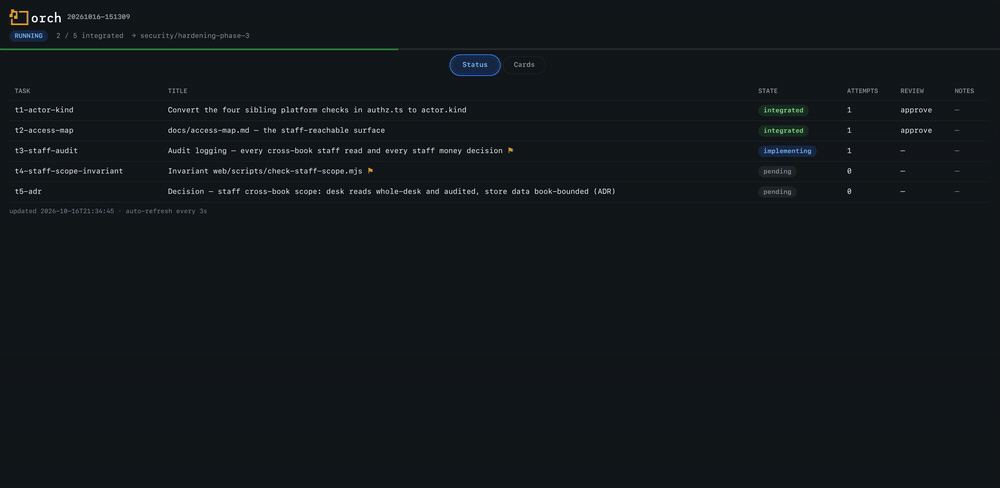
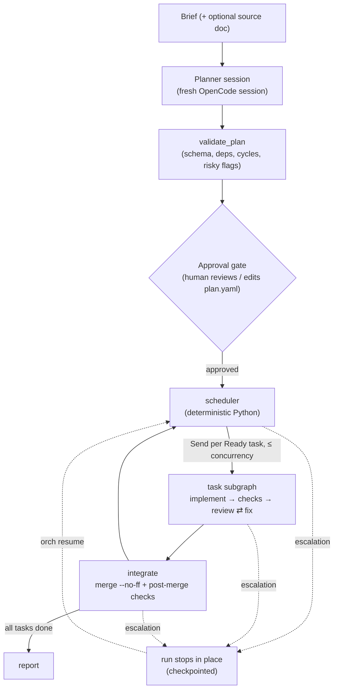

<p align="center">
  
</p>

# orch

<p align="center">
  
</p>

**Parallel agent development with review parity.**

`orch` is a [LangGraph](https://github.com/langchain-ai/langgraph) control plane that executes an approved plan as a task DAG: several coding-agent tasks in flight at once, each implemented by a headless [OpenCode](https://opencode.ai) session in its own git worktree, each independently reviewed, and each merged into a single **integration branch** only after review *and* checks pass.

You do exactly three things: **approve the plan**, **resolve genuine escalations**, and **promote the branch**. Everything else — scheduling, implementation, verification, review loops, merging — runs unattended.

## Why

Sequential agent workflows are safe but slow: each task waits for the one before it, even when its real prerequisites are already done. `orch` removes the wait without loosening quality — **review parity is the invariant, parallelism is the optimization.** Nothing unreviewed is merged, no check result is taken on trust, and `main` is never touched.

## What it guarantees

- **Independent review, always** — every task is judged by a *fresh* reviewer session (never the implementer's session) against the task contract, the orchestrator-generated diff, and the check evidence.
- **Deterministic pass/fail** — checks are shell commands the *orchestrator* runs in the task worktree. Exit codes are the truth; output is archived as evidence. Worker self-reports are advisory only.
- **Nothing unreviewed merges** — only Approved tasks merge, only into the integration branch, only with `--no-ff`. `main` and remotes are never touched; orch never pushes.
- **A scheduler you can explain** — readiness, concurrency caps, file-ownership exclusion, deadlock detection, and merge decisions are plain Python over the plan. Two tasks whose `files_allowed` overlap never run concurrently.
- **One pinned model per role, no substitution** — every role runs the model configured for it (the run `model`, or its `role_models` override); if it's unavailable, the run *stops and escalates* instead of silently falling back.
- **Risk is pre-authorized, not assumed** — pattern-flagged tasks (migrations, auth, payments, …) are listed at the approval gate for explicit pre-authorization; runtime surprises (reviewer `risky: true`, destructive commands, retries exhausted) still stop the run.
- **Crash-safe by construction** — one SQLite checkpoint store per run; `orch resume` re-enters exactly where the graph stopped. After approval the plan is hash-pinned — a modified `plan.yaml` is refused.
- **Single-writer discipline** — a run lock (`state/orch.lock`) prevents concurrent runs over one state; a dirty tracked tree refuses run start.

## How it works



Task lifecycle:

```
Ready → Implementing → Review → (Fixing ⟲) → Approved → Integrated
```

`Ready` means every dependency is *Integrated*. `Approved` means checks are green **and** the reviewer approved — neither condition alone suffices. `Integrated` means the commit is merged into the integration branch and its checks pass again on the merged result. Any escalation stops the loop in place; `orch resume` continues it.

Each task runs on its own branch (`agent/<TASK-ID>`) in its own worktree (`<target>/.worktrees/<TASK-ID>/`), created from the integration branch tip. The scheduler re-evaluates the moment any task integrates — no fixed waves.

## Quick start

Requirements:

- **Python ≥ 3.14** ([uv](https://docs.astral.sh/uv/) recommended — `uv.lock` pins the toolchain)
- **[OpenCode](https://opencode.ai) CLI** on `PATH`, configured with your providers — orch runs *all* model work through it (`opencode run`) and never calls provider APIs itself. No API keys live in orch.
- **git**

```bash
# 1. Install
git clone https://github.com/bigoninja/orch-dev.git
cd orch-dev
uv sync

# 2. Point orch at a target repo (writes orch.config.yaml — edit model/base_ref there)
uv run orch init /path/to/target-repo

# 3. Plan — planner session → runs/<run-id>/plan.yaml (nothing executes yet)
uv run orch plan "Add rate limiting to the public API" --from docs/design.md

# 4. Execute — validates the plan, then stops at the human approval gate
uv run orch run --run <run-id>

# 5. Review the plan and the run board, then approve
uv run orch status --run <run-id>
uv run orch approve --run <run-id>          # add --edit to adjust the plan, --accept-risky to pre-authorize

# 6. Watch live, or continue after an escalation/crash
uv run orch dashboard --run <run-id>        # local auto-refreshing board on 127.0.0.1
uv run orch resume --run <run-id>
```

## CLI

| Command | What it does |
|---|---|
| `orch init <target-repo>` | Write a config template (validates the target is a git repo); create `state/` and `runs/` |
| `orch plan "<brief>" [--from <doc>]` | Run the Planner and write `plan.yaml` — planning only; does not invoke the graph |
| `orch run [--yes]` | Validate the plan and execute; stops cleanly at the approval gate (`--yes` approves immediately) |
| `orch approve [--edit] [--accept-risky]` | Resume past the gate; plan is re-validated and hash-pinned |
| `orch resume [--task <id>]` | Continue after an escalation or crash; retry a specific task |
| `orch status [--json]` | Print the run board (`status.md`) or raw `state.json` |
| `orch dashboard [--port 8765]` | Serve a read-only, auto-refreshing progress page (task table + kanban) |
| `orch version` | Print the version |

Every command takes `--config <path>` (default `orch.config.yaml`) and `--run <id>` (defaults to the latest eligible run).

**Exit codes:** `0` success or awaiting approval · `2` escalation · `1` error.

## Configuration

`orch.config.yaml` (written by `orch init`):

| Key | Default | Meaning |
|---|---|---|
| `target_repo` | — (required) | Path to the git repo orch operates on |
| `base_ref` | `main` | Ref the integration branch forks from |
| `integration_branch` | `orch/integration` | Where Approved tasks merge |
| `worktree_root` | `.worktrees` | Per-task worktrees, relative to `target_repo` |
| `model` | `opencode/deepseek-v4.1-flash-free` | Default model for every role; a role listed in `role_models` overrides it |
| `role_models` | `{}` | Per-role model pins, keyed `planner`/`implement`/`review`/`fix`/`repair`; unlisted roles use `model`. Configured pins, not runtime substitutions |
| `concurrency` | `3` | Max tasks in flight (1–8) |
| `retries` | `2` | Fix attempts after the first implement (0–5) |
| `timeout_minutes` | `45` | Per role-step timeout (min 5) |
| `env_passthrough` | `[]` | Env var names force-exported to workers/checks (e.g. `DATABASE_URL`); secrets stay in the shell — never in the config |
| `risky_patterns` | migrations / auth / payments / gateway / `.github` / package files / `**/*.env*` | Globs that flag tasks risky at the gate |
| `notify` | `none` | Reserved (push notifications not built in v1) |
| `state_dir` | `state` | Run-lock location |
| `runs_dir` | `runs` | Run artifacts location |

## Concepts

| Term | Meaning |
|---|---|
| **Plan** | The task DAG (`plan.yaml`) the Planner writes from your brief; you approve it before anything runs |
| **Task** | A bounded unit of work: id, dependencies, `files_allowed`, acceptance criteria, checks |
| **Checks** | Explicit shell commands (`test` / `lint` / `typecheck`) — the deterministic pass/fail evidence |
| **Planner / Worker / Reviewer** | The three agent roles; Worker and Reviewer never share a session |
| **Session** | One OpenCode conversation answering one role-step |
| **Run** | One execution over a plan: its own run-id, artifacts directory, and checkpoints |
| **Integration branch** | Where Approved tasks merge automatically; promotion to `main` is always human |
| **Escalation** | The run stopping to request a human decision |

Full domain language: [`GLOSSARY.md`](GLOSSARY.md).

## Run artifacts

```
runs/<run-id>/
├── plan.yaml          # approved input; immutable after approval (hash-pinned)
├── state.json         # machine-readable status snapshot (what the dashboard serves)
├── status.md          # human run board, regenerated on every state change
├── checkpoints.db     # SQLite checkpoint store — the resume authority
├── evidence/          # <TASK-ID>.diff, check outputs, reviewer verdicts
└── logs/              # <TASK-ID>.{implement,checks,review[,fixN]}.log
```

`runs/` is relative to where you invoke `orch` — run it from the orch repo, and target-repo worktrees stay under `<target_repo>/.worktrees/`.

## Escalations

An escalation pauses the run and records a `kind` in `orch status`. Fix the cause, then `orch resume`:

| Kind | Meaning | Recovery |
|---|---|---|
| `task_retries_exhausted` | Fix budget spent; reviewers still reject | Fix the cause or task brief → `orch resume --task <id>` |
| `repair_exhausted` | A post-merge failure the one bounded repair couldn't fix | Fix by hand on the integration branch → `orch resume` |
| `model_unavailable` | The pinned model/provider was unreachable | Restore availability → `orch resume` |
| `risk_reviewer` | Reviewer flagged risky; task wasn't pre-authorized | Restart from the gate with `--accept-risky` |
| `plan_changed` | `plan.yaml` no longer matches the pinned hash | Restore the pinned plan, or restart with a fresh one |
| `deadlock` | Nothing Ready, nothing in flight, tasks remain | Fix the plan, restart the run |

Hard-stops (`destructive_command`, `adapter_timeout`, `verdict_unparseable`, `check_spawn_error`) mean what they say: fix the cause and `orch resume`.

## Design principles

- **OpenCode sessions are the sole LLM runtime** — planning, implementation, and review all run as `opencode run` subprocesses pinned to their configured role model. The planner has real repo tools, the reviewer can execute checks inside the task worktree, and review independence comes from fresh sessions.
- **Deterministic scheduler, no LLM supervisor** — a wrong schedule is a bug to fix in code, not a prompt to tune, and the whole loop is reproducible under the Mock adapter.
- **Orchestrator-owned commits** — the worker's self-report is advisory; the orchestrator stages, commits, and generates the diff it hands to review.
- **Exactly one bounded repair** per integration failure that is clearly local to a single task; anything else escalates to a human.
- **Promotion to `main` is deliberately not automated.**

## Development

```bash
uv sync                                   # env (includes pytest via the dev group)
uv run pytest                             # unit + Mock E2E — token-free
ORCH_SMOKE=1 uv run pytest tests/smoke    # real OpenCode/model calls, opt-in, tiny cost
```

- `fixtures/demo-repo` + the scripted Mock adapter drive the primary regression suite — the full loop (plan → approve → parallel execution → reject/fix → integration → report) with zero tokens.
- Layout: `src/orch/` (cli, graph, scheduler, plan, guard, checks, gitops, artifacts, dashboard, adapters) · `tests/{unit,e2e,smoke}/`.
- Maintenance note: `langgraph` is pinned to a verified minor line because orch reads node-local state through LangGraph private internals (`CONFIG_KEY_READ`) — a bumped read contract must be re-verified, not adopted implicitly (see `tests/e2e/test_e2e_parallel_isolation.py`).

## Status & scope

**v0.1.0** — the v1 loop is implemented and covered by the token-free Mock E2E suite; the real OpenCode adapter is smoke-tested against live sessions. It is currently piloted against a private codebase.

- **In v1:** planner → approval gate → dependency-aware execution → review/fix loops → integration, checkpoints & resume, status + dashboard, risky pre-authorization, bounded repair.
- **Not in v1:** push notifications, HTTP-API adapter, hard spend caps, mid-run replanning (restart with a fresh plan — completed commits persist), issue-tracker sync, multi-repo state, worktree garbage collection.
- **Honest note:** parallelism pays off on wide plans. A first, largely sequential pilot exercises the unattended review loop and a clean integration branch; wall-clock speedup arrives with plans that decompose wider.

## Documentation

- [`GLOSSARY.md`](GLOSSARY.md) — the domain language

## License

MIT — see [LICENSE](LICENSE).
